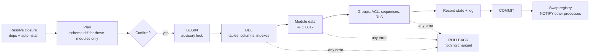

# RFC 0019: Apps, guided installer, and module install/uninstall

- **Status:** Accepted (2026-10-19, recommendations in §11 adopted)
- **Date:** 2026-10-19
- **Depends on:** 0002 (modules), 0014 (security), 0017 (module data), migrate package
- **Answers:** RFC 0002 §11 open question 1 and §12 "runtime module install/uninstall"

## 1. Summary

1. **Apps are modules with a storefront.** `defineModule` gains `application`, `icon`, `category`, `summary` and
   `autoInstall`. This is enough for a CLI or Kosh to show an app catalog with icons, and no new concept is added.
2. **Shutro ships the official apps** `settings`, `account`, `sale`, `purchase` and `project` (with `base`). A fresh
   install puts them all in by default, and `shutro.config.ts` can change that list.
3. **`shutro init` becomes a guided installer.** It checks the environment, shows a dependency tree, shows progress per
   step with icons, and ends with a summary. It still works without a TTY: plain text, `--yes`, `--json`.
4. **Install and uninstall work per database.** The config lists the modules that are *available*. The database records
   which ones are *installed*. `shutro apps install|uninstall|upgrade` and `shutro.apps.*` change that state. Each
   operation runs in **one PostgreSQL transaction**, so it fully succeeds or does nothing.
5. **Uninstall can be undone by default.** An uninstalled app's tables move to a quarantine schema instead of being
   dropped. Reinstalling within the retention window restores the data. `--purge` drops the tables, but only after
   showing the row counts and asking for confirmation.

## 2. Problem & ERP requirements

| #   | Requirement |
| --- | ----------- |
| R1  | **First run in minutes:** one command goes from an empty directory to a working database with the core business apps, an admin user and a company. |
| R2  | **Default apps:** after a fresh install, Accounting, Sales, Purchase, Project and Settings are installed without any further steps. |
| R3  | **Install an app later** on a live database. Dependencies are resolved automatically, and nothing is half-installed if a step fails. |
| R4  | **Uninstall an app** and see exactly what will be lost first: tables, columns other apps added, row counts, records that refer to it. Uninstall is refused when installed apps still depend on it, unless those are removed too. |
| R5  | **Audit-ready:** install, upgrade and uninstall are logged (who, when, version, plan). Audit rows from an uninstalled app are never deleted. |
| R6  | **Glue modules** (`sale_purchase`, `sale_project`) install themselves when all of their dependencies are installed, and uninstall when one is removed. |
| R7  | **Kosh can build an app store** from metadata alone: name, icon, category, summary, state, dependencies, dependents. |
| R8  | **Types stay honest:** code must never call into a model whose app is not installed and fail with an obscure SQL error. |
| R9  | **CI and scripts** get the same operations with no prompts, no colors and machine-readable output. |

## 3. How Odoo does it

`ir.module.module` stores each module's state (`uninstalled`, `to install`, `installed`, `to upgrade`, `to remove`).
The Apps menu installs modules, and every database has its own registry, which is rebuilt after each operation.
`auto_install` handles glue modules. Uninstall drops the module's tables and columns and deletes its `ir.model.data`
records.

**Weaknesses:**

| #  | Weakness | Consequence |
| -- | -------- | ----------- |
| W1 | **Install is not atomic.** Every module commits separately, and some steps run outside the transaction. | A failed install leaves modules stuck in `to install`. This is a common support ticket, usually fixed by hand in SQL. |
| W2 | **Uninstall is destructive and blind.** There is no preview of what gets lost, and no undo. | Clicking "Uninstall" on Accounting deletes years of data. A backup is the only way back. |
| W3 | **Cross-module columns disappear silently.** Uninstalling `sale_stock` drops columns from `sale_order` without saying so. | Reports and integrations break later. |
| W4 | **No real CLI UX.** `odoo-bin -i module` prints a log wall, and there is no plan, progress or summary. | Operators can't tell what happened or how long it will take. |
| W5 | **Python code is always loaded,** even for uninstalled modules, and is guarded only by registry state. | Code that touches an uninstalled model fails with `KeyError` or SQL errors at runtime. |

## 4. Prior art

- **Package managers** (pnpm, apt): a resolved plan is shown before anything changes, a dependency tree, a single
  confirmation, a progress view, and an `--yes` switch for automation.
- **Rails / Laravel installers** (`rails new`, `laravel new`): interactive choices with flags for every answer, and the
  same command runs non-interactively.
- **Prisma / Drizzle / Kysely / MikroORM**: none of them have modules or an install state. Schema changes are only
  applied through migrations. This RFC keeps that discipline: every DDL statement an install runs is recorded in the
  migration ledger.

## 5. Options

### Option A: Config only (status quo, with nicer output)

The apps are whatever `shutro.config.ts` lists. To install an app, you edit the config and run `shutro migrate apply`.
There is no runtime install.

### Option B: Fully dynamic per-database registries (Odoo model)

Each database has its own registry, which is rebuilt in-process from its installed set. Apps can be installed from Kosh
at runtime, with no restart.

### Option C: Available in config, installed in the database, one registry rebuilt on change

The config lists the *available* modules, which is an upper bound and is what the types are generated from. The database
records which ones are *installed*. When the process starts, and after every install or uninstall, it builds the registry
from the installed set and swaps it in atomically. Code that reaches a model whose app isn't installed gets
`AppNotInstalledError`, which names the app and the command to install it. `env.apps.has('purchase')` narrows the type,
so it can be used as a guard.

| Criterion | A | B | C |
| --- | --- | --- | --- |
| R3/R4 install & uninstall at runtime | ✖ (deploy needed) | ✔ | ✔ |
| R8 types honest | ✔ exact | ✖ unknown at compile time | ✔ upper bound + typed guard |
| Multi-database process with different apps | ✖ | ✔ | ✔ (one registry per installed-set fingerprint, shared between databases with the same set) |
| Complexity | low | high | medium |
| Matches RFC 0002 view-safety rules | ✔ | ✖ | ✔ (the S-rules already require extensions to be safe when *absent*) |

## 6. Decision

We choose **Option C**. It meets every requirement and keeps the compile-time story from RFC 0002. The only change is
that the application view becomes an upper bound, which a single typed guard handles.

## 7. Detailed design

### 7.1 App metadata on modules

```ts
export const purchase = defineModule({
  name: 'purchase',
  version: '1.0.0',
  label: 'Purchase',
  application: true,                      // listed in the app catalog (non-applications are "technical" modules)
  icon: './icon.svg',                     // SVG resolved relative to the module file; Kosh serves it
  glyph: '🛒',                            // terminal fallback; plain-text mode prints [purchase]
  category: 'Inventory & Purchasing',
  summary: 'Requests for quotation, purchase orders, vendor bills',
  depends: [base, account, product],
  models: [PurchaseOrder, PurchaseOrderLine],
  groups: [/* ... */],
  data: [/* ... */],
  uninstall: {                            // optional, see §7.6
    blockers: async (ctx) => [],          // reasons to refuse (e.g. posted vendor bills exist)
  },
});

export const salePurchase = defineModule({
  name: 'sale_purchase',
  depends: [sale, purchase],
  autoInstall: true,                      // R6: installed with the last of its dependencies, removed with the first
  extensions: [/* ... */],
  models: [],
});
```

`defineModule` validates the new metadata. `icon` must be an SVG of at most 64 KB, `category` comes from an open
list, and `autoInstall` modules can't be `application: true`. `describe()` returns all of it (§9).

### 7.2 The official apps (`@shutro/apps`)

A new package in this repo. Each app is a normal module, so applications can extend it with `extendModel` like any
other module. v1 covers the core flows end to end. Later revisions can go further.

| App | Glyph | Module(s) | v1 models |
| --- | ----- | --------- | --------- |
| Settings | ⚙️ | `settings` (+ `base`) | `res.company`, `res.users`, `res.currency`, `res.currency.rate`, `res.config` (typed per-company settings), groups UI data |
| Accounting | 📒 | `account` | `account.account`, `account.journal`, `account.tax`, `account.payment.term`, `account.move`, `account.move.line`, `account.payment`, fiscal year/lock dates |
| Sales | 💼 | `sale` | `sale.order`, `sale.order.line`, pricelist (basic) |
| Purchase | 🛒 | `purchase` | `purchase.order`, `purchase.order.line` |
| Project | 📋 | `project` | `project.project`, `project.task`, `project.task.stage`, timesheet line (optional, `project_timesheet` glue) |
| (glue) | | `sale_account`, `purchase_account`, `sale_project`, `sale_purchase` | invoicing from orders, task from order line, etc. All `autoInstall`. |

`partner` and `product` are technical modules that the apps depend on. They are installed automatically and don't
appear as apps. The current `examples/erp-demo` modules become the starting point for `partner`, `product`, `sale` and
`account`. The demo then turns into an application that *extends* the official apps, which is a better test of RFC
0002 than defining everything itself.

### 7.3 Configuration

```ts
// shutro.config.ts
import { defineConfig } from '@shutro/cli';
import { officialApps } from '@shutro/apps';

export default defineConfig({
  modules: [...officialApps, './modules/my_custom/module.ts'],  // available (upper bound, typed)
  install: ['settings', 'account', 'sale', 'purchase', 'project'], // installed on a fresh database (this is the default)
  quarantine: { retentionDays: 30 },                             // uninstall safety net (§7.6)
  migrations: './migrations',
});
```

When `install` is omitted, the five default apps are installed. Dependencies and `autoInstall` glue are always added
automatically.

### 7.4 State and storage

`shutro_module` (owned by the migrate package) gets new columns:

```sql
ALTER TABLE shutro_module
  ADD COLUMN state text NOT NULL DEFAULT 'installed'
    CHECK (state IN ('installed', 'quarantined', 'uninstalled')),
  ADD COLUMN installed_by text,           -- login, or 'cli'
  ADD COLUMN quarantined_at timestamptz;
```

There are no `to install` / `to remove` states. Operations are atomic (§7.5), so a module is never left between
states. This removes Odoo W1 completely. Every operation also writes a row to
`shutro_module_log (id, op, modules, plan jsonb, actor, started_at, finished_at, outcome)`. The audit trail
(RFC 0013) reads this table, and it is never deleted (R5).

### 7.5 Install, step by step (atomic)



- **One transaction per operation.** PostgreSQL DDL is transactional, so tables, data, groups and state commit together
  or not at all. `pg_advisory_xact_lock` serializes concurrent operations on one database.
- **The schema comes from the diff, scoped to the modules.** `planMigration` gets an `only: modules` option. The
  statements it produces are stored in the ledger as `install:<module>@<version>` with a checksum, so
  `shutro migrate status` and other environments stay in step. Destructive statements never appear in an install plan.
- **Other processes** subscribe with `LISTEN shutro_modules`. They rebuild their registry when a notification arrives
  and swap it in between transactions. A transaction that is already running finishes on the registry it started with.

### 7.6 Uninstall: preview, refuse, quarantine, purge

```text
$ shutro apps uninstall purchase

  🛒 Uninstall Purchase 1.0.0

  Also removed (depend on it)
    └─ sale_purchase (glue, auto)

  Data affected                                       rows
    purchase_order                                   1,284   ⟶ quarantine
    purchase_order_line                              6,903   ⟶ quarantine
    account_move.purchase_id   (column on Accounting)  412   ⟶ quarantine
    sale_order_line.purchase_line_id (sale_purchase)    97   ⟶ quarantine

  ⚠ 412 vendor bills refer to purchase orders. The link is kept in quarantine, and the bills stay intact.
  ✔ Audit history is kept (never deleted).

  Recoverable for 30 days: shutro apps install purchase restores everything.
  Proceed? (y/N)
```

- **Refused** when installed apps depend on the module and the caller hasn't confirmed removing them as well. It is also
  refused when a module's `uninstall.blockers` returns reasons. For example, `account` refuses while posted entries
  exist in an unlocked period.
- **Quarantine (the default):** each table moves with `ALTER TABLE ... SET SCHEMA shutro_quarantine`. Each column that
  other modules' tables got from the uninstalled module is copied into a quarantine side table
  `(table, id, values jsonb)` and then dropped. External ids, groups and sequences get `state = 'quarantined'`.
  Reinstalling within the retention window moves everything back, data included. When the window has passed,
  `shutro apps purge` drops the quarantined objects. The time is checked lazily on the next CLI or `apps.*` call; there
  is no scheduler.
- **`--purge`** skips quarantine. It needs a typed confirmation of the app name, or `--yes --purge` in CI.
- `uninstalled` is the final state. The row is kept for audit, and you can install the app again from scratch.

### 7.7 CLI: the guided installer and `shutro apps`

```text
$ npx shutro init my-erp

  ◆ Shutro 0.3.0 · the ORM for business software

  ✔ Node.js 24.3 detected
  ✔ PostgreSQL 18.1 at localhost:5432 (database my_erp created)
  ? Company name  › Paragon Ltd
  ? Currency      › BDT
  ? Admin login   › admin@example.com
  ? Apps          › (space to toggle)
      ◉ ⚙️  Settings        required
      ◉ 📒 Accounting
      ◉ 💼 Sales
      ◉ 🛒 Purchase
      ◉ 📋 Project

  Install plan  (9 modules, 41 tables)
    base ─┬─ partner ─┬─ product ─┬─ sale ──────┬─ sale_account (auto)
          │           │           └─ purchase ──┴─ purchase_account (auto)
          ├─ settings │
          └─ account ─┘           project ───── sale_project (auto)

  Installing  ━━━━━━━━━━━━━━━━━━━━━━━━━━━━━━━━━━━━━━━━  9/9   3.8s
    ✔ base                0.2s     ✔ sale              0.6s
    ✔ settings            0.3s     ✔ purchase          0.5s
    ✔ partner             0.2s     ✔ project           0.4s
    ✔ product             0.3s     ✔ glue (3 modules)  0.3s
    ✔ account             1.0s

  ✔ Ready in 4.1s. 5 apps, 1 company, 1 admin.

  Next
    cd my-erp
    shutro apps list          see what's installed
    shutro apps install …     add more apps
```

Commands:

| Command | What it does |
| --- | --- |
| `shutro init [dir]` | Guided installer (above). Every prompt has a flag: `--company`, `--currency`, `--admin`, `--apps settings,account`, `--database`, `--yes`. |
| `shutro apps list` | Catalog: glyph, name, version, state, category. `--all` also lists technical modules. |
| `shutro apps info <app>` | Summary, dependencies tree, dependents, models, data size. |
| `shutro apps install <app...>` | Plan → confirm → progress → summary (§7.5). |
| `shutro apps uninstall <app...>` | Preview → confirm → quarantine or `--purge` (§7.6). |
| `shutro apps upgrade [app...]` | Version bump: data-migration hooks + module data, same atomic pipeline. |
| `shutro apps purge` | Drop quarantined objects past retention (or `--now <app>`). |
| `shutro doctor` | Checks Node, PostgreSQL version, connectivity, extensions, pending migrations, stale bindings, and quarantine. Each check prints ✔/⚠/✖ with the fix. |

**Rendering rules:**

- Built on `node:util` `styleText` and ANSI cursor control. No new dependency.
- Glyphs and colors are used only when stdout is a TTY, `NO_COLOR` is unset and the terminal supports Unicode.
  Otherwise the output is plain text (`[ok] account 1.0s`).
- `--json` prints one event per line (`plan`, `step`, `done`, `error`). Kosh uses this format, and so can CI.
- Errors keep the project style: what went wrong, then how to fix it. After a rollback the summary says
  "nothing was changed".

### 7.8 Programmatic API (for Kosh's app store)

```ts
const catalog = await shutro.apps.list();          // AppInfo[]: name, label, icon, glyph, category, summary, state, depends, dependents
const plan = await shutro.apps.plan({ install: ['purchase'] });   // InstallPlan: modules, statements, estimated rows
const result = await shutro.apps.install(['purchase'], {
  actor: env.user,                                  // logged in shutro_module_log
  onEvent: (e) => progress.push(e),                 // same events as --json
});

await shutro.run({ user, company }, async (env) => {
  if (env.apps.has('purchase')) {                   // narrows env.model('purchase.order') from `never`-guarded to usable
    await env.model('purchase.order').search({ where: { state: 'purchase' } });
  }
});
```

Only users in `base.admin` can install or uninstall (RFC 0014). The ACL check happens before planning.

## 8. Type-level guarantees

- `env.model('purchase.order')` is typed from the available set. It throws `AppNotInstalledError` when the app is not
  installed (R8). There is no silent SQL error.
- `env.apps.has(name)` is a type predicate over the generated union of available module names. Misspelled names are
  compile errors.
- `defineModule({ autoInstall: true, application: true })` is a compile error (a union type), and so is
  `install: ['purchse']` in `defineConfig`.

```ts
expectTypeOf(env.apps.has).parameter(0).toEqualTypeOf<'base' | 'settings' | 'account' | 'sale' | 'purchase' | 'project' | /* … */ string & {}>();
// @ts-expect-error unknown app
defineConfig({ modules: officialApps, install: ['purchse'] });
```

## 9. Runtime metadata

`registry.describe()` and `shutro.apps.list()` expose, per module: `application`, `icon` (resolved URL path),
`glyph`, `category`, `summary`, `autoInstall`, `state`, `installedVersion`, `availableVersion`, `depends`,
`dependents`, `models`. `shutro inspect` shows the same information.

## 10. Interactions

- **0002:** the application view becomes an upper bound. View-safety rule S1 (required fields from extensions need a
  default) is what makes adding an extension at runtime safe.
- **0013:** install, upgrade and uninstall are audited as `module:<op>`. Audit rows of quarantined or purged models
  remain.
- **0014:** groups and ACL of an uninstalled module are deactivated with it. RLS policies are regenerated in the same
  transaction.
- **0017:** `loadData` runs inside the install transaction. Quarantined external ids are reactivated on reinstall
  instead of being recreated.
- **migrate:** gets `planMigration({ only })`, install ledger entries, and the new `shutro_module` columns. Plain
  `shutro migrate apply` keeps working for teams that prefer config-only deployments (Option A stays available as a
  workflow).

## 11. Resolved questions

| # | Decision |
| - | -------- |
| 1 | **The apps live in this repo** as `packages/apps` (`@shutro/apps`). |
| 2 | **v1 covers the core flows only:** order → confirm → invoice → payment, and project → task → stage. Full accounting (reconciliation, reports, localizations) gets its own RFCs. |
| 3 | **Uninstall quarantines by default,** with a 30-day retention. `--purge` drops the data. |
| 4 | **`base` and `settings` are required** and cannot be uninstalled. |
| 5 | **`init` loads a generic chart of accounts.** Localizations (`l10n_bd` first) come later. |

## 12. Deferred

- A web UI for the app store. That belongs to Kosh, which uses §7.8 and §9.
- A remote app registry or marketplace (installing apps from npm at runtime).
- Per-company installed apps. The installed set is per database.
- Localization modules beyond a generic chart of accounts.

## 13. Implementation plan (after approval)

Each step is one PR, done test-first against PostgreSQL. `pnpm typecheck && pnpm lint && pnpm test` must pass at every
step.

1. Module metadata (`application`, `icon`, `glyph`, `category`, `summary`, `autoInstall`) + `describe()` + type tests.
2. `shutro_module` state columns + `shutro_module_log` + `planMigration({ only })`.
3. Install pipeline (atomic, advisory lock, ledger, registry swap, NOTIFY) + `AppNotInstalledError` + `env.apps`.
4. Uninstall: dependents closure, impact preview, blockers, quarantine/restore, purge.
5. CLI renderer (TTY/plain/JSON) + `shutro apps *` + `shutro doctor`.
6. Guided `shutro init` with default apps.
7. `@shutro/apps`: `settings`, `partner`, `product`, `account`, then `sale`, `purchase`, `project`, then glue modules.
   Port `examples/erp-demo` to extend them.
8. Docs: `docs/guides/apps.md`, then update CLAUDE.md roadmap.
